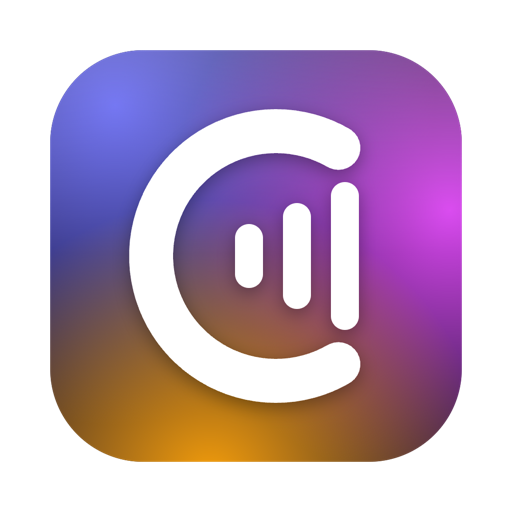

# Cadence

Cadence is a fast, native music player for your self-hosted library (Navidrome, OpenSubsonic,
Jellyfin), with YouTube Music discovery, personal mixes and player-to-player control.

<p align="center">
  
</p>

It is written in Rust with a [Slint](https://slint.dev) interface and [mpv](https://mpv.io) for
playback, and uses a fraction of the memory of an Electron player (about 90 MB PSS with every
view open). Runs on Linux and macOS.

## Features

- Navidrome, Jellyfin and OpenSubsonic/Subsonic servers (tested against Navidrome, gonic and
  Jellyfin) and several servers per install.
- Library: home, tracks, albums, artists, genres, folders, favorites, playlists (create, edit,
  reorder), global search, ratings and context menus. Huge libraries are paged from the server
  while you scroll.
- Playback through libmpv: gapless, crossfade, ReplayGain, output device, maximum bitrate and
  transcoding, sleep timer, full-screen now playing, play queue synced with the server.
- Synced and plain lyrics (server, lrclib, NetEase, Genius), scrobbling, MPRIS media keys,
  macOS Now Playing and media keys, Discord Rich Presence, share links, internet radio (server stations and radio-browser.info).
- Discover: YouTube Music recommendations, new releases, charts and moods; songs in your
  library play from your server, others through `yt-dlp`. Personal mixes built from what you
  play and favorite: up to four Daily Mixes that blend your songs with similar ones, and a
  Discover Weekly of songs you do not have, renewed every Monday.
- Control another Cadence on your network, Spotify Connect style: the Devices button in the player
  bar lists the other players, controls one of them and moves the music (queue and position)
  between them. Being controlled is off by default (Settings > Integrations > Remote control) and
  each device has to be approved the first time. A player that is controlled listens on TCP port
  47390; open it in its firewall for your local network only, for example
  `sudo ufw allow from 192.168.0.0/24 to any port 47390 proto tcp` or `sudo firewall-cmd --permanent
  --zone=home --add-source=192.168.0.0/24 --add-port=47390/tcp && sudo firewall-cmd --reload`
  (use your own network's address range).
- 31 themes with light/dark following the system and an accent color, 39 languages.
- The screen does not lock and the system does not sleep while music is playing.

## Install

### Linux

Requirements: `mpv` (libmpv), a Wayland or X11 desktop and at least one font.

```sh
rust/scripts/install.sh              # builds and installs into ~/.local
rust/scripts/install.sh --uninstall
```

Arch Linux users can build the `cadence-git` package from `rust/packaging/arch`, and
`rust/packaging/appimage/build-appimage.sh` builds a portable AppImage. See
[rust/packaging/README.md](rust/packaging/README.md).

Settings live in `~/.config/cadence`, passwords in the system keyring (Secret Service).

### macOS

`rust/packaging/macos/build-app.sh` builds `Cadence.app` with libmpv bundled, plus a zip of it,
under `rust/target/macos`. It needs `brew install mpv dylibbundler` and Xcode's command line
tools. The app is signed ad hoc, so the first launch has to be allowed in System Settings >
Privacy & Security. Discover needs `brew install yt-dlp`.

Settings live in `~/Library/Application Support/cadence`, the cache in
`~/Library/Caches/cadence` and passwords in the login keychain.

### Updates

Cadence checks GitHub for a new release once per launch and offers it in a small prompt; it never
restarts on its own. The macOS app and the AppImage update themselves after you accept, verifying
the download's SHA-256 first. Other installs get a link to the release page. See
[rust/packaging/README.md](rust/packaging/README.md#how-updates-work).

## Development

The Cargo workspace is in [`rust/`](rust). It needs a Rust toolchain, `libmpv`, `fontconfig`,
`xkbcommon` and `dbus` development files on Linux, and `brew install mpv pkg-config` on macOS.

```sh
cd rust
cargo run -p cadence                         # the app
cargo run -p cadence -- --demo               # a generated library and silent audio, no server needed
cargo clippy --workspace --all-targets -- -D warnings
cargo test --workspace
scripts/live-servers.sh up && scripts/live-servers.sh test   # API tests against real servers in containers
```

Code standards are in [rust/CLAUDE.md](rust/CLAUDE.md).

## Translation

Translations are gettext catalogs in `rust/app/translations/<language>/LC_MESSAGES/cadence.po`.
After adding or changing text in the app, run `rust/scripts/translations.py` to add the new
strings to every catalog, then fill in the `msgstr` entries of your language. Many strings
were machine translated and corrections are welcome (`rust/scripts/translations.py check
<language>` validates a catalog).

## Credits

The README animation is made with [Remotion](https://www.remotion.dev).

## License

[MIT](LICENSE)
